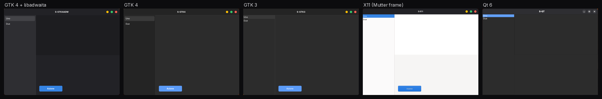
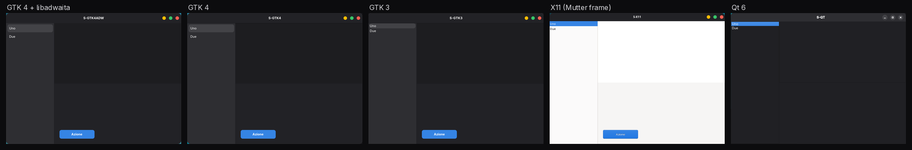
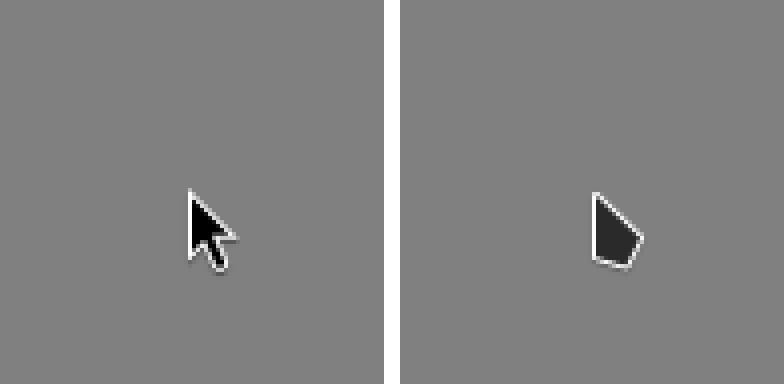
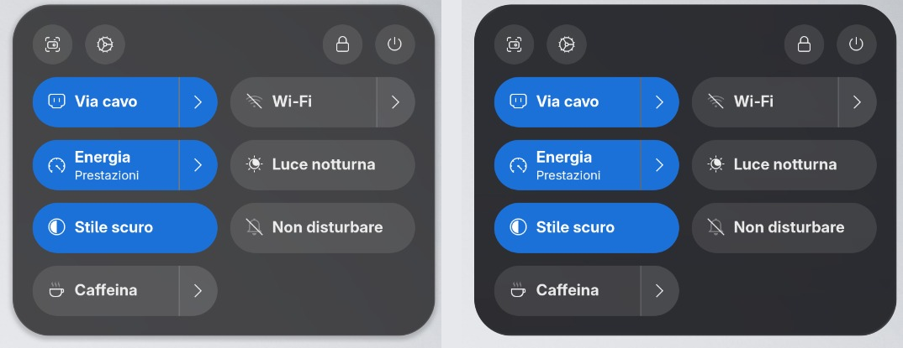
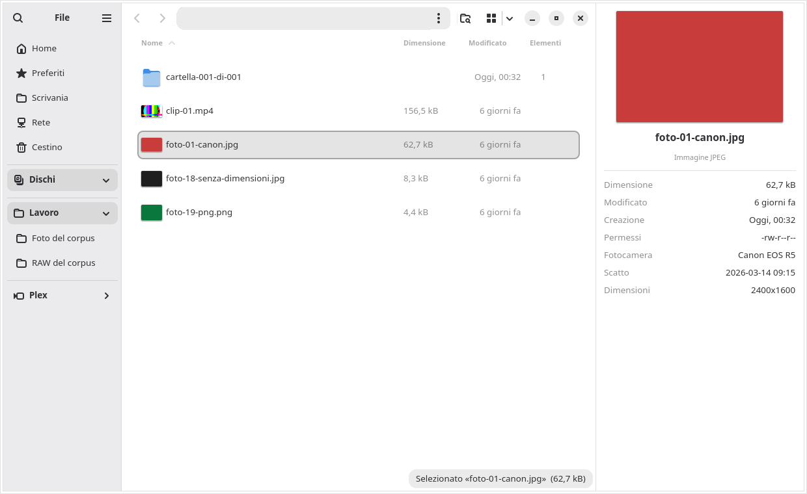
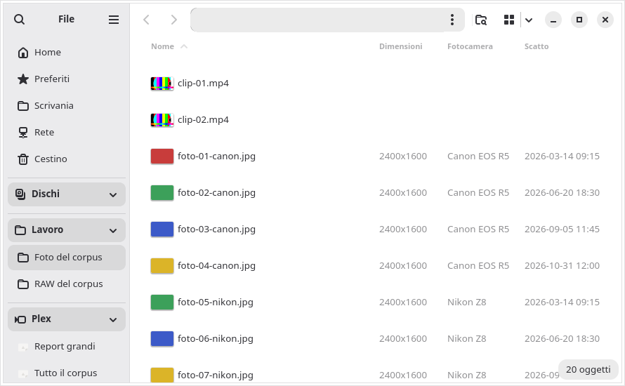

<h1 align="center">CodLab Thema</h1>

<p align="center"><b>Ein GNOME-Desktop, der fertig wirkt: ein Grau, ein Blau, ein Mauszeiger, ein Dateimanager, der mehr kann als Explorer und Finder – und ein ehrlicher Bericht darüber, wie weit wir sind.</b></p>

<p align="center"><a href="README.md">English</a> · Deutsch · <a href="README.it.md">Italiano</a></p>

> **Stand: 1. November 2026.** Ein funktionierender Prototyp auf einer Entwicklungs-Workstation (Fedora 45,
> GNOME Shell 51, GTK 4.24, libadwaita 1.10), **noch kein installierbares Paket**. Dieses Repository ist ein
> öffentlicher Bericht: was wir gemessen haben, wofür wir uns entschieden haben, was fertig ist und was nicht. Code und
> Pakete erscheinen hier Stück für Stück, sobald jedes Stück eine unabhängige Prüfung bestanden hat.

## Inhalt

1. [Das Problem: die Brüche](#1-das-problem-die-brüche)
2. [Was wir gemessen haben](#2-was-wir-gemessen-haben)
3. [Unsere Entscheidungen](#3-unsere-entscheidungen)
4. [Dateien: mehr als Explorer und Finder](#4-dateien-mehr-als-explorer-und-finder)
5. [Apps starten wie auf dem Mac](#5-apps-starten-wie-auf-dem-mac)
6. [Wie wir arbeiten](#6-wie-wir-arbeiten)
7. [Ehrlicher Stand](#7-ehrlicher-stand)
8. [Was kein Theme lösen kann](#8-was-kein-theme-lösen-kann)
9. [Der Weg zum Paket](#9-der-weg-zum-paket)
10. [Namen, Dank, Lizenz](#10-namen-dank-lizenz)

## 1. Das Problem: die Brüche

Unter macOS oder Windows fällt selten auf, wer das Fenster gezeichnet hat, das man gerade sieht. Auf einem
Linux-Desktop fällt es oft auf. Von einer App zur nächsten zeigen sich die Brüche: ein etwas anderes Grau, ein anderes
Blau, Fensterknöpfe in einem anderen Stil, ein Mauszeiger, der seine Form ändert, eine App, die aus einem anderen
Jahrzehnt zu stammen scheint.

Jeder Bruch ist klein. Zusammen sind sie der Abstand, den man zwischen Linux und den beiden kommerziellen Desktops
spürt – selbst dort, wo Linux schneller, flexibler und offener ist. **CodLab Thema soll diesen Abstand schließen**:
jeder Bruch, den wir beeinflussen können, wird gemessen und geschlossen; jeder, den wir nicht beeinflussen können, wird
benannt.

## 2. Was wir gemessen haben

### 2.1 Wer Ihre Apps eigentlich zeichnet

Die GNOME Shell und die GNOME-Apps verwenden GTK 4 mit libadwaita. Die Apps, die man den ganzen Tag benutzt, oft
nicht. Auf unserem Prototyp verwenden von den **17 im Dock angehefteten Apps nur 5** GTK 4 mit libadwaita:

| Toolkit | Apps im Dock |
|---|---|
| GTK 4 + libadwaita | 5 |
| Chromium / Electron (Browser, Chat, Passwortmanager …) | 5 |
| Qt 6 | 2 |
| Flutter | 1 |
| Gecko | 1 |
| GTK 3 | 1 |
| X11 / CEF (Steam) | 1 |
| Ein Spiel | 1 |

Ein Theme erreicht nur Apps, die das System fragen, wie sie sich zeichnen sollen: GTK 3, GTK 4 und teilweise Qt.
**Apps, die alles selbst zeichnen, erreicht kein Theme** – Chrome mit eigenem Theme, Electron, Flutter, Steam, Spiele.
Das sagen wir vorab, statt es wegzuversprechen (siehe [§8](#8-was-kein-theme-lösen-kann)).

### 2.2 Wie weit „dasselbe Theme" wirklich auseinanderliegt

Selbst unter den Apps, die ein Theme erreicht, hatte der Ausgangsdesktop **zwei Grautöne und drei Blautöne**:
GTK-4-Apps nutzten das kühle Grau und Blau von libadwaita, GTK-3-Apps und X11-Fensterrahmen das neutrale Grau und ein
helleres Blau des Themes, und die Shell ein drittes Blau.

Gemessen haben wir das in einer **isolierten Sitzung**: eine GNOME Shell 51 ohne Bildschirm mit einer Kopie der
Einstellungen, gleicher Skalierung und fünf kleinen eigenen Testfenstern, eines pro Toolkit. Die Farben werden aus den
Pixeln gelesen und mit CIEDE2000 verglichen (ΔE00; grob gesagt ist 1 ein gerade wahrnehmbarer Unterschied, ab 2 sieht
man ihn, wenn zwei Fenster nebeneinanderstehen).

| Fläche (größter Unterschied zwischen GTK 4 + libadwaita, GTK 4, GTK 3 und einem X11-Rahmen) | Vorher | Nachher |
|---|---:|---:|
| Akzent (Auswahl, Knöpfe) | 7,81 | **0,00** |
| Inhaltsbereich | 5,17 | **0,00** |
| Seitenleiste | 4,28 | **0,00** |
| Fensterhintergrund | 4,21 | **0,00** |
| Kopfleiste | 2,93 | **0,00** |

Auch der Abstand der Fensterknöpfe ist jetzt überall gleich: 30 px zwischen den Knopfmitten bei allen vier, aus einem
einzigen Design-Token. Qt ist die Ausnahme und als teilweise erklärt: Seine Kopfleiste liegt noch 3,8 auseinander, und
seine Knöpfe bleiben grau (§7).

**Vorher** – dieselben fünf Testfenster, dieselbe Sitzung:



**Nachher** – aus einer einzigen Token-Datei erzeugt:



<sub>Beim X11-Fenster zeichnet das System nur den Rahmen; die weiße Fläche zeichnet das Testprogramm selbst. Das
Qt-Fenster behält graue Knöpfe (teilweise, siehe §7). Die Beschriftungen in den Fenstern sind Testtexte.</sub>

### 2.3 Der Mauszeiger, der seine Form änderte

Die GNOME Shell 51 zeichnet Mauszeiger aus SVG-Dateien (ein Ordner `cursors_scalable/`). Das verwendete Zeiger-Theme
lieferte nur Bitmaps, also griff die Shell still auf ihren eingebauten Pfeil zurück, während GTK-3- und X11-Apps das
Theme nutzten: zwei verschiedene Pfeile auf einem Bildschirm und **12 Fehler „Could not load cursor" im Protokoll einer
einzigen Anmeldung**. Nach der Umwandlung des Themes in das SVG-Format der Shell: **0**.



### 2.4 Warum nicht einfach ein anderes Theme?

- **Ein vollständiges Theme über libadwaita bricht zweimal im Jahr.** Das Ausgangs-Theme legte 9.536 Zeilen CSS mit
  höchster Priorität über libadwaita. Es änderte Formen, aber nicht die Grundgrautöne (daher die Brüche oben), und es
  veränderte sogar App-Layouts: Ein Taschenrechner war 365 px breit statt 360.
- **Distributionen, die nahtlos wirken, verdecken die Brüche meist nur.** Zorin OS etwa patcht libadwaita, damit sein
  Theme geladen wird, und bleibt jahrelang auf einer festen GNOME-Basis; laut eigener Dokumentation fallen Flatpak- und
  Snap-Apps auch dort heraus, ebenso Chrome mit einem Web-Store-Theme, Electron und Steam. Die Idee – eine Familie für
  alle Ebenen – lohnt sich. Unter GNOME 51 gibt es diese Familie bereits ohne Patches: **Adwaita**.
- **Einen libadwaita-Patch haben wir trotzdem untersucht.** Eine Portierung mit 186 Zeilen funktioniert und lässt die
  Schnittstelle der Bibliothek unverändert. Für das gewählte Aussehen brauchen wir ihn nicht, und Flatpak-Apps würde er
  nicht erreichen, weil sie die libadwaita ihrer Laufzeitumgebung verwenden.

## 3. Unsere Entscheidungen

| Entscheidung | Was sie bedeutet | Warum |
|---|---|---|
| **Verfeinertes Standard-Adwaita aus einer Token-Datei** | Eine `tokens.toml` erzeugt die Stile für GTK 4, GTK 3, die Shell und die Qt-Farben | Eine einzige Quelle kann nicht auseinanderdriften. Die Tests werden rot, wenn eine erzeugte Datei eine von Hand geschriebene Farbe enthält oder sich eine Bibliothek darunter ändert: 35 von 35 absichtlich kaputten Varianten wurden erkannt. Bei der alten Konfiguration fand derselbe Test 283 Farben außerhalb der Tokens. |
| **Ein Grau, ein Blau, ein Radius** | Die Flächen von libadwaita, das System-Blau von GNOME als Akzent, 15 px Fensterradius | Der Systemakzent erreicht die Shell und Flatpak-Apps von selbst; bei keiner Version muss man etwas nachziehen. |
| **Symbole und Ampelknöpfe von Colloid** | Das Colloid-Symbolset; Fensterknöpfe als 16-px-Kreise mit 30 px Abstand, gezeichnet von wenigen eigenen Regeln, identisch bei GTK 4, GTK 3 und X11-Rahmen; grau in inaktiven Fenstern | Der Charakter, den man mag, bleibt – bei einem Bruchteil der Pflege eines vollständigen Themes. |
| **Ein Mauszeiger** | Der Colloid-Zeiger im SVG-Format der Shell, dazu Bitmaps für GTK 3 und X11 | Ein Pfeil, scharf auch bei gebrochener Skalierung. |
| **Flüssiges Glas** | Obere Leiste, Dock und Pop-ups der Shell nutzen einen Lichtbrechungseffekt (über die Erweiterung *Blur my Shell*), abgestimmt auf eine getönte Variante, die Richtung von macOS 27 | Jeder Text und jedes Symbol auf dem Glas wird gegen die WCAG-Kontrastregel geprüft; eine Variante, die irgendein Element gegenüber vorher verschlechtert, wird verworfen. Die helle Variante (4,37:1) und die Voreinstellung der Erweiterung (2,97:1) fielen durch. |
| **Ein leistungsfähigeres Dateien** | Patches und Erweiterungen für Nautilus, ausgeliefert als eigener Build des Pakets | §4 |
| **Ein App-Starter wie auf dem Mac** | Ein Vollbild-Starter und ein hüpfendes Dock-Symbol, als Erweiterungen der GNOME Shell | §5 |

Die Token-Datei ist klein und lesbar. Ein Auszug aus der echten Datei (die Schlüssel sind italienisch: *accento* =
Akzent, *raggi* = Radien, *semafori* = Ampelknöpfe, *passo* = Abstand):

```toml
[accento]
nome_gnome = "blue"
bg = "#3584e4"

[raggi]
finestra = 15

[semafori]
diametro = 16
passo = 30
chiudi = "#fd5f51"
riduci = "#fdbe04"
ingrandisci = "#38c76a"
```

Flüssiges Glas im Schnelleinstellungsmenü, gleicher heller Hintergrund – vorher (Unschärfe) und nachher (getöntes Glas,
installiert):



## 4. Dateien: mehr als Explorer und Finder

Als Werkzeug ist der Windows-Explorer vollständiger als GNOME Dateien (Nautilus): Detailbereich, Gruppierung,
Metadatenspalten, ein Suchbereich. Dateien ist aufgeräumter und einheitlicher. Wir schließen die Lücke in Dateien selbst,
in kleinen Versionen unseres eigenen Builds (`…codlab`), jede mit einem Rückweg zur vorherigen.

| Funktion | Was sie tut | Stand |
|---|---|---|
| **Elementanzahl** | Eine Spalte „Elemente" für Ordner, sortierbar und zwischengespeichert; jetzt einmal statt zweimal gezählt (Verzeichnisdurchläufe pro Ordner 2,00 → 1,00, gemessen mit `strace`) | ✅ installiert · freigegeben |
| **RAW-Vorschaubilder** | Vorschauen für CR2, CR3, NEF, ARW, RAF, DNG, ORF und RW2 aus dem in der Datei eingebetteten JPEG; keine neuen Pakete | ✅ installiert · freigegeben · geprüft mit einem synthetischen Korpus, *teilweise* bei echten Kameradateien |
| **Fotospalten** | Abmessungen, Kamera und Aufnahmedatum in der Listenansicht | ✅ installiert · freigegeben |
| **Suche „nur hier"** | „Nur hier" oder „auch in Unterordnern" im Such-Pop-over, wie im Explorer; mit „nur hier" wird kein Ordner unterhalb des aktuellen geöffnet | ✅ installiert · freigegeben |
| **Detailbereich** | Alt+P oder das Menü: große Vorschau und Metadaten der gewählten Datei (EXIF mit Ausrichtung, Dauer und Auflösung von Videos, Gesamtgröße eines Ordners); der Zustand bleibt gespeichert; keine neuen Abhängigkeiten | ✅ installiert · freigegeben |
| **Gruppieren nach** | Typ, Datum oder Größe, mit Abschnittsüberschriften wie im Explorer | 🧪 geschrieben und isoliert getestet · Prüfung noch nicht begonnen |
| **Seitenleisten-Blöcke** | Gruppen wie *Laufwerke* und *Arbeit*, mit Laufwerksnamen, Farben und Füllstandsbalken | ✅ auf dem Prototyp installiert · noch nicht geprüft · soll vom Benutzer konfigurierbar werden |
| Als Nächstes | Konfigurierbare Blöcke, Doppelfenster, eine Startansicht | 📋 geplant |





<sub>Testdaten aus einem synthetischen Korpus. Die Pfadleiste ist ausgeblendet: Sie zeigte die Ordner unseres
Prüfstands.</sub>

## 5. Apps starten wie auf dem Mac

macOS 26 hat das Launchpad zugunsten einer „Apps"-Ansicht und Spotlight entfernt, und macOS 27 bleibt dabei. Was vielen
fehlt, ist die Geste: **eine Taste, alle Apps, tippen, los.** Wir haben sie für die GNOME Shell 51 als zwei Erweiterungen
gebaut:

- **Launchpad CodLab** – Super öffnet ein Vollbild-Raster aller Apps über dem Glas, der Schreibtisch blendet an Ort und
  Stelle aus; Tippen filtert; Esc schließt mit einem Druck; Super+W zeigt die Fenster.
- **Hüpfen im Dock** – das Dock-Symbol hüpft, während eine App startet, wie unter macOS, auch wenn die App langsam
  startet. Genau dort scheiterte die erste Version; der Test simuliert jetzt einen Start von drei Sekunden.

Ein Spotlight-Nachbau von Dritten wurde getestet und verworfen: Er meldete Fehler unter Shell 51, übernahm die Suche
und brachte die isolierte Test-Shell einmal zum Absturz. Ein eigenes Spotlight ist der nächste Schritt.

**Stand:** in der isolierten Sitzung nachgewiesen, noch nicht installiert. Einer der beiden Prüfer hat freigegeben, der
andere noch nicht (Bedienbarkeit 9,6 bei einer Schwelle von 9,8). *Bildschirmfotos folgen: Die aus der Testsitzung
zeigen ein Hintergrundbild eines Dritten und ein persönliches Dock und werden auf neutralem Hintergrund neu
aufgenommen.*

## 6. Wie wir arbeiten

Jedes Stück durchläuft dieselbe Kette, und auf die Kette kommt es an:

1. **Ein Autor, zwei unabhängige Prüfer.** Jedes Stück schreibt ein Modell, geprüft wird es von mehreren unabhängigen
   Modellen. Die beiden Prüfer, die freigeben, lesen das Urteil des anderen nicht, und **sie führen aus**: Sie
   reproduzieren Fehler, machen Rot-vorher/Grün-nachher-Prüfungen und Mutationstests (absichtlich kaputte Kopien, die
   die Tests erkennen müssen). **Wer schreibt, gibt die eigene Arbeit nie frei.**
2. **Eine Note pro Bereich, kein Durchschnitt.** Ein Stück wird bei 9,5 von 10 in jedem Bereich ausgeliefert. Für den
   Desktop liegt die Latte bei **9,8 pro Bereich**, dazu ausdrückliche Felder gegen macOS 27 und Windows 11 – „schöner:
   ja oder nein, mit Quelle und Beleg". Eine 9,7 ist ein Nein.
3. **Ein Tor vor jeder Prüfung.** Sauberer Checkout, vollständige Testsuite und ein Prüfprogramm, das tatsächlich rot
   werden kann. Eine Prüfung, die nie fehlschlägt, prüft nichts.
4. **Isolation.** Jeder visuelle Test läuft in einer isolierten GNOME Shell ohne Bildschirm mit kopierter
   Einstellungsdatenbank – nie in der laufenden Sitzung, keine Tastendrücke, keine Klicks.
5. **Zuerst der Rückweg.** Jede Änderung ist eine nummerierte Scheibe mit festgehaltenem Vorher-Zustand; ihr Rückweg
   wird ausgeführt und gemessen, bevor die Scheibe zählt.
6. **Ehrliche Messungen.** Zeiten werden nur auf einer unbelasteten Maschine gemessen (Linux-Pressure-Stall-Information
   unter festen Schwellen); sonst gilt die Messung als **ungültig** – nie ein falsches Rot oder ein falsches Grün. Was
   sich nicht nachweisen lässt, wird als **teilweise** erklärt.
7. **Höchstens drei Abschlussrunden** pro Schritt; danach wird der Schritt geteilt.

Ein echtes Beispiel: Bei Dateien 1.7.1 lehnten beide Prüfer die erste Runde ab – ein fehlendes Einstellungsschema
konnte Dateien abbrechen lassen, und ein neuer Knopf im Such-Pop-over war nicht verbunden. Nach einer Abschlussrunde mit
Rot-vorher/Grün-nachher-Beleg für jeden Fehler gaben beide frei, und es wurde installiert.

## 7. Ehrlicher Stand

Stand 1. November 2026, auf der Prototyp-Workstation:

| Stück | Auf dem Prototyp | Unabhängige Prüfung |
|---|---|---|
| Verfeinerte Adwaita-Basis aus einer Token-Datei (ein Grau, ein Blau, ein Radius) | ✅ installiert | 🟡 Korrekturen und Tests von beiden freigegeben; die 9,8-Latte „besser als macOS 27 und Windows 11" noch nicht (9,5 · 9,7) |
| Ampelknöpfe bei GTK 4, GTK 3 und X11-Rahmen | ✅ installiert | 🟡 wie oben · Qt behält graue Knöpfe (*teilweise*; ein Umweg ist vorbereitet, nicht installiert) |
| Ein Mauszeiger (SVG für die Shell, Bitmaps für GTK 3 und X11) | ✅ installiert | 🟡 einer von zwei bei 9,8 (9,8 · 9,7) |
| Flüssiges Glas, getönt, in der Shell | ✅ installiert am 1. November, auf ausdrückliche Entscheidung des Eigentümers | 🟡 einer von zwei freigegeben; der andere: 9,1 bei 9,5 für „Schönheit gegenüber macOS 27" (Tiefe der großen Flächen) |
| Flüssiges Glas, nächste Abstimmung (neueres *Blur my Shell*) | 🧪 vorbereitet, nicht installiert | ⏳ nicht geprüft |
| Glas in den Apps (GTK 4, zuerst die Seitenleiste von Dateien) | 🧪 in Arbeit | ⏳ nicht geprüft |
| Dateien 1.7.1: Elementanzahl, RAW-Vorschauen, Fotospalten, Suche „nur hier" | ✅ installiert | ✅ von beiden freigegeben nach einer Abschlussrunde · RAW *teilweise* bei echten Kameradateien |
| Dateien 1.8.1: Detailbereich | ✅ installiert | ✅ von beiden freigegeben nach einer Abschlussrunde |
| Dateien 1.9: Gruppieren nach | 🧪 in Arbeit | ⏳ Prüfung noch nicht begonnen |
| Seitenleisten-Blöcke von Dateien mit Laufwerksnamen, Farben und Füllstandsbalken | ✅ installiert | ⏳ noch nicht geprüft |
| Launchpad CodLab und Hüpfen im Dock | 🧪 vorbereitet, nicht installiert | 🟡 einer von zwei freigegeben; der andere: Bedienbarkeit 9,6 bei 9,8 |
| Chrome folgt dem System-Theme | 🧪 vorbereitet · braucht einen Klick in den Einstellungen von Chrome | 🟡 9,7 · 9,7 |
| Einheitliche Symbole im Benachrichtigungsfeld | ⚠️ *teilweise* | manche Apps von Dritten laden ihr Symbol über einen Dateipfad oder als Bitmap: Eine Überschreibung auf Benutzerebene gibt es nicht |
| Das Paket: `codlab-thema`, signiertes Repository, automatischer Neubau | 📋 geplant | – |

✅ erledigt · 🟡 teilweise freigegeben · 🧪 vorbereitet oder in Arbeit · ⏳ ausstehend · ⚠️ teilweise · 📋 geplant

## 8. Was kein Theme lösen kann

- **Apps, die sich selbst zeichnen**: Chrome (außer im GTK-Modus), Electron- und Flutter-Apps, Steam, Spiele. macOS hat
  mit Electron dasselbe Problem, gibt aber jedem Fenster dieselben Ecken und denselben Schatten; GNOME zeichnet den
  Rahmen von Wayland-Apps nicht.
- **Flatpak-Apps mit libadwaita** verwenden die Bibliothek ihrer Laufzeitumgebung, nicht die des Systems. Sie erhalten
  nur das Stylesheet des Benutzers und den Systemakzent. Deshalb besteht das CodLab-Aussehen aus den eigenen Variablen
  von libadwaita plus wenigen stabilen Regeln.
- **GNOME unterstützt keine Themes für seine Apps** („Please don't theme our apps", 2019). Was unsere Stile kaputt
  machen, beheben wir: Bitte melden Sie es uns, nicht GNOME.
- **Funktionen, die an Apple-Geräte gebunden sind** (Continuity mit dem iPhone), haben unter Linux keinen Weg.

## 9. Der Weg zum Paket

**CodLab Thema wird ein einziges Paket**: ein Name zum Installieren, Aktualisieren und Entfernen, eine Version, eine
Einstellungs-App. Das Metapaket `codlab-thema` zieht nach:

| Teil | Paket |
|---|---|
| Aus den Tokens erzeugte Stile | `codlab-stile` |
| Erweiterungen der GNOME Shell (Glas, Starter, Dock, Feinschliff) | `codlab-shell` |
| Unser Build von Dateien | `nautilus` (gleicher Name, Release-Endung `.codlab`) |
| Erweiterungen für Dateien (Spalten, Vorschauen) | `nautilus-codlab` |
| CodLab-Einstellungen, mit „CodLab-Profil anwenden" und „Zurück wie vorher" | `codlab-impostazioni` |
| Signiertes Repository | `codlab-repo` |

Grundsätze: **die Aktualisierungen der Distribution nie blockieren** – fehlt unser Build oder kommt er später, gewinnt
das Fedora-Paket, und der Desktop fällt auf Standard-Adwaita zurück; nichts geht kaputt. Pakete werden auf einer eigenen
Build-Maschine gebaut und anderswo signiert; die Signaturschlüssel bewegen sich nie. Installation und vollständiger
Rückweg werden vor jeder Version in einer sauberen virtuellen Maschine getestet. Die nächste GNOME-Version (52) wird für
den 17. März 2027 erwartet.

| Schritt | Inhalt |
|---|---|
| I0 | Bestandsaufnahme der Einstellungen des Prototyps: allgemein, maschinenspezifisch, zu entfernen |
| I1 | „Stil 0": ein Grau, ein Blau – die Token-Generatoren als Paket |
| I2 | Der CodLab-Mauszeiger |
| I3 | Patches für Dateien aufgeräumt und geprüft, eigenes Einstellungsschema |
| I3b | Vom Benutzer konfigurierbare Seitenleisten-Blöcke; Laufwerksnamen und -farben ohne Eingriff in Systemdateien |
| I3c | Das CodLab-Profil mit „Anwenden" und „Zurück wie vorher" |
| I4 | Pakete, signiertes Repository, getesteter Rückweg |
| I5 | Automatischer Neubau bei jeder Aktualisierung der Distribution, mit Tor |
| | **→ CodLab Thema 1.0** |
| I6–I13 | Dateien: Detailbereich, Gruppieren und Filter, Schlagwörter, Tippen-und-Springen, Startansicht, Doppelfenster → **v1, „besser als Explorer und Finder"** |

Unsere Schätzung in Prüfketten-Tagen (ein Schritt durch Schreiben, Tor und zwei ausführende Prüfungen, höchstens drei
Runden): **16–23 für Version 1.0** und **38–57 für v1**; 7–10 pro GNOME-Version für die Pflege von 1.0. Zuerst kommen
unsere eigenen Rechner; ein öffentliches Repository nach einer stabilen Version.

## 10. Namen, Dank, Lizenz

**Namen.** CodLab Thema ist ein Arbeitstitel. Es steht in keiner Verbindung zur GNOME Foundation, zu Fedora, Apple oder
Microsoft und wird von ihnen nicht unterstützt. Wir verwenden ihre Namen nicht in unseren Produktnamen und kopieren
keine ihrer Symbole, Mauszeiger oder Schriften. „Flüssiges Glas" beschreibt den Effekt; unserer heißt CodLab Vetro.

**Aufgebaut auf der Arbeit** des GNOME-Projekts (Shell, Mutter, GTK, libadwaita, Dateien), von adw-gtk3, den Colloid-
Symbol- und -Zeiger-Themes, der Erweiterung *Blur my Shell* und von Fedora. Danke.

**Lizenz.** Der Text dieses Berichts steht unter [CC BY 4.0](LICENSES/CC-BY-4.0.txt), die Bildschirmfotos in `docs/img/` unter [CC BY-SA 4.0](LICENSES/CC-BY-SA-4.0.txt), weil sie Symbole und Mauszeiger aus GPL- bzw. CC-BY-SA-Themes zeigen. Später hier veröffentlichter Code steht unter GPL-3.0-or-later (Patches für Nautilus GPL-3.0-or-later, für dessen Erweiterungsbibliothek LGPL-2.1-or-later, GNOME-Shell-Erweiterungen GPL-2.0-or-later), pro Datei mit SPDX-Kopfzeilen. Komponenten Dritter behalten ihre eigenen Lizenzen. Siehe [LICENSE.md](LICENSE.md).

---

<p align="center">Ein Projekt von <a href="https://codlab.de/projects/">CodLab</a> · Regensburg</p>
