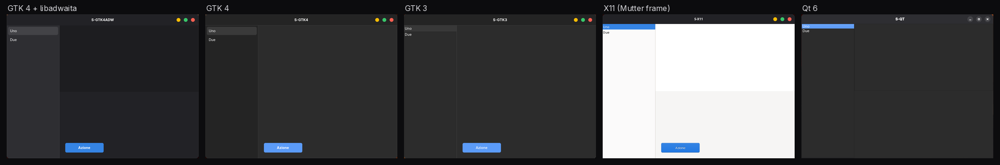
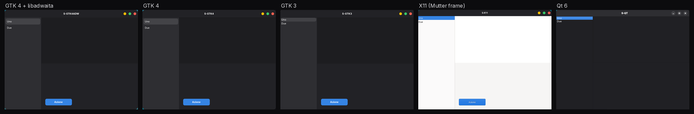
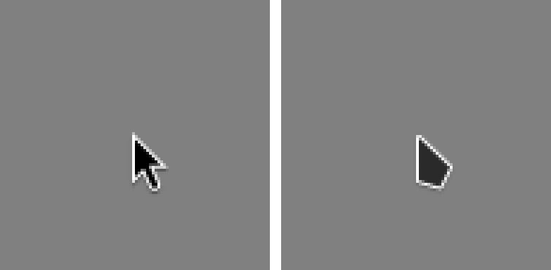
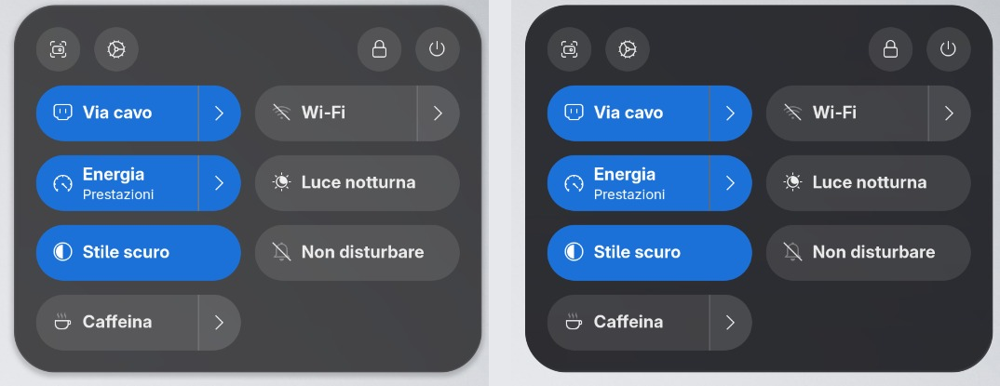
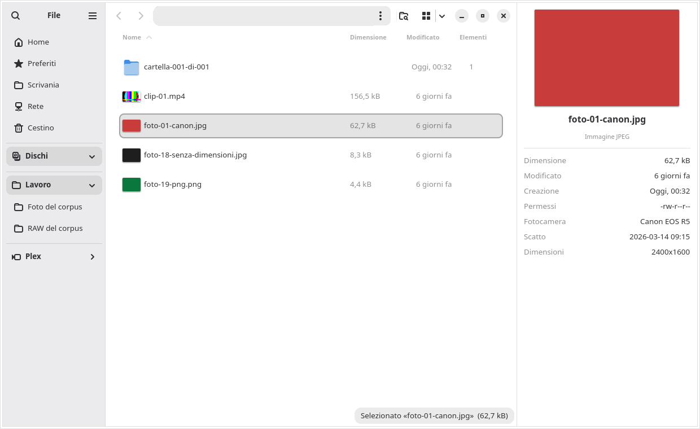
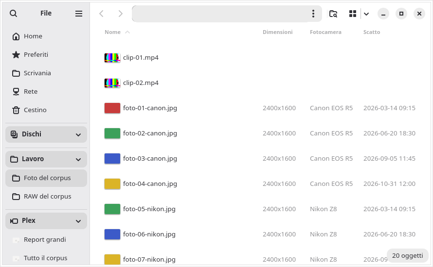

<h1 align="center">CodLab Thema</h1>

<p align="center"><b>Un desktop GNOME che sembra finito: un grigio, un blu, un cursore, un file manager sulla strada per fare più di Esplora file e Finder — e un resoconto onesto di dove siamo arrivati.</b></p>

<p align="center"><a href="README.md">English</a> · <a href="README.de.md">Deutsch</a> · Italiano</p>

> **Stato al 5 novembre 2026.** Un prototipo funzionante su una postazione di sviluppo (Fedora 45, GNOME Shell 51,
> GTK 4.24, libadwaita 1.10), **non ancora un pacchetto installabile**. Questo repository è un resoconto pubblico —
> cosa abbiamo misurato, cosa abbiamo scelto, cosa è fatto e cosa no — e, dal 5 novembre, anche il **codice sorgente
> dei pezzi installati su quella postazione**, pubblicato così com'è installato ([§11](#11-il-codice-in-questo-repository)).
> Quali pezzi hanno le firme dei revisori indipendenti lo dice il [§7](#7-stato-onesto). I pacchetti verranno dopo.

## Indice

1. [Il problema: gli stacchi](#1-il-problema-gli-stacchi)
2. [Cosa abbiamo misurato](#2-cosa-abbiamo-misurato)
3. [Le nostre scelte](#3-le-nostre-scelte)
4. [File: verso più di Esplora file e Finder](#4-file-verso-più-di-esplora-file-e-finder)
5. [Aprire le app come su un Mac](#5-aprire-le-app-come-su-un-mac)
6. [Come lavoriamo](#6-come-lavoriamo)
7. [Stato onesto](#7-stato-onesto)
8. [Cosa nessun tema può risolvere](#8-cosa-nessun-tema-può-risolvere)
9. [La strada verso il pacchetto](#9-la-strada-verso-il-pacchetto)
10. [Nomi, ringraziamenti, licenza](#10-nomi-ringraziamenti-licenza)
11. [Il codice in questo repository](#11-il-codice-in-questo-repository)

## 1. Il problema: gli stacchi

Su macOS o su Windows raramente ci si accorge di chi ha disegnato la finestra che si sta guardando. Su un desktop Linux
spesso sì. Passando da un'app all'altra si vedono gli stacchi: un grigio un po' diverso, un altro blu, pulsanti della
finestra in un altro stile, un cursore che cambia forma, un'app che sembra arrivare da un altro decennio.

Ogni stacco è piccolo. Insieme sono la distanza che si sente fra Linux e i due desktop commerciali, anche dove Linux è
più veloce, più flessibile e più aperto. **CodLab Thema nasce per chiudere quella distanza**: ogni stacco che possiamo
governare, misurato e chiuso; ogni stacco che non possiamo governare, dichiarato.

## 2. Cosa abbiamo misurato

### 2.1 Chi disegna davvero le app

Le app di GNOME usano GTK 4 con libadwaita (la GNOME Shell invece si disegna con un toolkit suo, St su Clutter). Le app
che si usano tutto il giorno spesso no. Sul nostro prototipo, delle **17 app fissate nel dock solo 5** usano GTK 4 con libadwaita:

| Toolkit | App nel dock |
|---|---|
| GTK 4 + libadwaita | 5 |
| Chromium / Electron (browser, chat, gestore di password, …) | 5 |
| Qt 6 | 2 |
| Flutter | 1 |
| Gecko | 1 |
| GTK 3 | 1 |
| X11 / CEF (Steam) | 1 |
| Un gioco | 1 |

Un tema raggiunge solo le app che chiedono al sistema come disegnarsi: GTK 3, GTK 4 e in parte Qt. **Nessun tema
raggiunge le app che disegnano tutto da sé** — Chrome col suo tema, Electron, Flutter, Steam, i giochi. Lo diciamo
subito invece di prometterlo (vedi [§8](#8-cosa-nessun-tema-può-risolvere)).

### 2.2 Quanto è lontano «lo stesso tema»

Anche fra le app che un tema raggiunge, il desktop da cui siamo partiti aveva **due grigi e tre blu**: le app GTK 4 con
il grigio freddo e il blu di libadwaita, le app GTK 3 e le cornici X11 con il grigio neutro e un blu più chiaro del
tema, e la Shell con un terzo blu.

L'abbiamo misurato in una **sessione isolata**: una GNOME Shell 51 senza schermo con una copia delle impostazioni, la
stessa scala e cinque piccole finestre di prova nostre, una per toolkit. I colori si leggono dai pixel e si confrontano
con CIEDE2000 (ΔE00; a grandi linee 1 è la differenza appena percepibile, sopra 2 la si vede con due finestre affiancate).

| Superficie (differenza massima fra GTK 4 + libadwaita, GTK 4, GTK 3 e una cornice X11) | Prima | Dopo |
|---|---:|---:|
| Accento (selezione, pulsanti) | 7,81 | **0,00** |
| Area del contenuto | 5,17 | **0,00** |
| Barra laterale | 4,28 | **0,00** |
| Sfondo della finestra | 4,21 | **0,00** |
| Barra del titolo | 2,93 | **0,00** |

Anche la spaziatura dei pulsanti della finestra ora è uguale ovunque: 30 px fra i centri dei pulsanti su tutti e
quattro, da un solo token di progetto. Qt è l'eccezione ed è dichiarato parziale: la sua barra del titolo resta a 3,8 e
i suoi pulsanti restano grigi (§7).

**Prima** — le stesse cinque finestre di prova, la stessa sessione:



**Dopo** — generate da un solo file di token:



<sub>Nella finestra X11 il sistema disegna solo la cornice; l'area bianca la disegna il programma di prova. La finestra
Qt mantiene i pulsanti grigi (parziale, vedi §7). Le scritte nelle finestre sono testi di prova.</sub>

### 2.3 Il cursore che cambiava forma

La GNOME Shell 51 disegna i cursori da file SVG (una cartella `cursors_scalable/`). Il tema di cursori che usavamo
aveva solo bitmap, così la Shell ripiegava in silenzio sulla sua freccia interna mentre le app GTK 3 e X11 usavano il
tema: due frecce diverse sullo stesso schermo e **12 errori «Could not load cursor» nel registro di un solo accesso**.
Dopo aver convertito il tema nel formato SVG della Shell: **0**.



### 2.4 Perché non semplicemente un altro tema?

- **Un tema completo sopra libadwaita va riadattato a ogni versione di GNOME, due volte l'anno.** Il tema di partenza aggiungeva 9.536 righe di CSS
  sopra libadwaita, alla priorità più alta. Cambiava le forme ma non i grigi di base (da qui gli stacchi sopra) e
  alterava perfino l'impaginazione delle app: una calcolatrice usciva larga 365 px invece di 360.
- **Le distribuzioni che sembrano senza stacchi per lo più li nascondono.** Zorin OS, per esempio, modifica libadwaita
  perché carichi il suo tema e resta per anni su una base GNOME fissa; per sua stessa documentazione le app Flatpak e
  Snap lì si staccano comunque, come Chrome con un tema del Web Store, Electron e Steam. L'idea — una sola famiglia per
  tutti gli strati — vale la pena di copiarla. Su GNOME 51 quella famiglia esiste già senza modifiche: **Adwaita**.
- **Una modifica a libadwaita l'abbiamo studiata comunque.** Un porting di 186 righe funziona e lascia identica
  l'interfaccia della libreria. Per l'aspetto che abbiamo scelto non serve, e non raggiungerebbe le app Flatpak, che
  usano la libadwaita del loro runtime.

## 3. Le nostre scelte

| Scelta | Che cosa vuol dire | Perché |
|---|---|---|
| **Adwaita di serie rifinito, da un solo file di token** | Un `tokens.toml` genera gli stili per GTK 4, GTK 3, la Shell e i colori di Qt | Una fonte sola non può divergere. Le prove diventano rosse se un file generato contiene un colore scritto a mano o se sotto cambia una libreria: 35 varianti guastate apposta su 35 sono state prese. Sulla configurazione di prima la stessa prova ha trovato 283 colori fuori dai token. |
| **Un grigio, un blu, un raggio** | Le superfici di libadwaita, il blu di sistema di GNOME come accento, un raggio di 15 px per le finestre | L'accento di sistema arriva da solo alla Shell e alle app Flatpak; niente da inseguire a ogni versione. |
| **Icone e pulsanti a semaforo da Colloid** | Il set di icone Colloid; i pulsanti della finestra come cerchi di 16 px con passo di 30 px, disegnati da poche regole nostre, identici su GTK 4, GTK 3 e cornici X11; grigi nelle finestre non attive | Si tiene il carattere che piace, con una frazione della manutenzione di un tema completo. |
| **Un cursore solo** | Il cursore Colloid nel formato SVG della Shell, più le bitmap per GTK 3 e X11 | Una freccia sola, nitida anche con la scala frazionaria. |
| **Vetro liquido** | Barra in alto, dock e menu della Shell usano un effetto di rifrazione (tramite l'estensione *Blur my Shell*) tarato su una variante tinta, la direzione presa da macOS 27 | Ogni testo e ogni icona attivi sono controllati con le soglie di contrasto WCAG (4,5:1 per il testo, 3:1 per le icone); una variante viene scartata se un elemento scende sotto la sua soglia, a meno che non ci fosse già prima e non peggiori. La variante chiara (4,37:1) e il predefinito dell'estensione (2,97:1) non sono passati. |
| **Un File più potente** | Modifiche ed estensioni a Nautilus, come nostra build del pacchetto | §4 |
| **Un lanciatore di app come su Mac** | Un lanciatore a tutto schermo e l'icona che rimbalza nel dock, come estensioni della GNOME Shell | §5 |

Il file dei token è piccolo e leggibile. Un estratto del file vero:

```toml
[accento]
nome_gnome = "blue"
bg = "#3584e4"

[raggi]
finestra = 15

[semafori]
diametro = 16
passo = 30
chiudi = "#fd5f51"
riduci = "#fdbe04"
ingrandisci = "#38c76a"
```

Vetro liquido sul menu rapido, stesso sfondo chiaro — prima (sfocatura) e dopo (vetro tinto, installato):



## 4. File: verso più di Esplora file e Finder

Come strumento, Esplora file di Windows è più completo di File di GNOME (Nautilus): riquadro dei dettagli,
raggruppamenti, colonne di metadati, un ambito di ricerca. File è più pulito e coerente. La distanza la chiudiamo dentro
File, in piccole versioni della nostra build (`…codlab`), ognuna con il ritorno alla precedente. Fare più di Esplora file e
Finder è l'obiettivo della v1 (§9); la tabella dice dove siamo oggi.

| Funzione | Che cosa fa | Stato |
|---|---|---|
| **Conteggio degli elementi** | Una colonna «Elementi» per le cartelle, ordinabile e con cache; ora contata una volta sola invece di due (letture della cartella 2,00 → 1,00, misurate con `strace`) | ✅ installata · firmata |
| **Anteprime RAW** | Anteprime per CR2, CR3, NEF, ARW, RAF, DNG, ORF e RW2, dal JPEG incorporato nel file; nessun pacchetto nuovo | ✅ installata · firmata · provata su un corpus sintetico, *parziale* sui file veri delle fotocamere |
| **Colonne foto** | Dimensioni, fotocamera e data di scatto nella vista a elenco | ✅ installata · firmata |
| **Ricerca «solo qui»** | «Solo qui» o «anche nelle sottocartelle» nel menu della ricerca, come in Esplora file; con «solo qui» non si apre nessuna cartella sotto quella corrente | ✅ installata · firmata |
| **Riquadro dettagli** | Alt+P o il menu: anteprima grande e metadati del file selezionato (EXIF con l'orientamento, durata e risoluzione dei video; con più file selezionati, la loro dimensione totale); lo stato viene ricordato; nessuna dipendenza nuova | ✅ installato · firmato |
| **Raggruppa per** | Tipo, data o dimensione, con intestazioni di sezione come in Esplora file | 🧪 scritto e provato in isolamento · revisione in attesa |
| **Blocchi della barra laterale** | Gruppi come *Dischi* e *Lavoro*, con nomi dei dischi, colori e barre dello spazio libero | ✅ installati sul prototipo · non ancora revisionati · diventeranno configurabili dall'utente |
| Prossimi | Blocchi configurabili, doppio pannello, una vista Home | 📋 in programma |





<sub>Dati di prova di un corpus sintetico. La barra del percorso è oscurata: mostrava le cartelle del nostro banco di
prova.</sub>

## 5. Aprire le app come su un Mac

macOS 26 ha tolto il Launchpad a favore di una vista «App» e di Spotlight, e macOS 27 resta così. Quello che manca a
molti è il gesto: **un tasto, tutte le app, si scrive, si parte.** L'abbiamo costruito per la GNOME Shell 51 come due
estensioni:

- **Launchpad CodLab** (nome di lavoro) — Super apre a tutto schermo la griglia delle app sopra il vetro, la scrivania svanisce sul
  posto; scrivendo si filtra; Esc chiude in un colpo; Super+W mostra le finestre.
- **Rimbalzo nel dock** — l'icona nel dock rimbalza mentre l'app parte, come su macOS, anche quando l'app è lenta a
  partire. La prima versione falliva proprio lì; ora la prova simula una partenza di tre secondi.

Un clone di Spotlight di terzi è stato provato e scartato: dava errori sulla Shell 51, si prendeva la ricerca e una
volta ha fatto cadere la Shell di prova isolata. Una ricerca nostra in stile Spotlight è il prossimo incremento.

**Stato:** provato nella sessione isolata, non ancora installato. Uno dei due revisori ha firmato, l'altro non ancora
(usabilità 9,6 contro una soglia di 9,8); le correzioni di quei punti sono scritte e aspettano una nuova revisione. *Le
immagini arriveranno: quelle della sessione di prova mostrano uno sfondo
di terzi e un dock personale, e saranno rifatte su uno sfondo neutro.*

## 6. Come lavoriamo

Ogni pezzo passa per la stessa catena, ed è la catena il punto:

1. **Uno scrive, due revisori indipendenti.** Ogni pezzo ha un autore e due revisori
   indipendenti. I due revisori che firmano non leggono il verdetto l'uno dell'altro, ed **eseguono**: riproducono i
   difetti, fanno prove rosso-prima/verde-dopo e prove a mutanti (copie guastate apposta che le prove devono prendere).
   **Chi scrive non firma mai il proprio lavoro.**
2. **Un voto per area, nessuna media.** Un pezzo entra nel pacchetto solo a 9,5 su 10 in ogni area. Per il desktop la soglia è
   **9,8 per area**, più caselle esplicite contro macOS 27 e Windows 11 — «più bello: sì o no, con fonte e prova». Un
   9,7 è un no.
3. **Un cancello prima di ogni revisione.** Copia pulita, suite di prove intera e un verificatore che può davvero
   diventare rosso. Un controllo che non fallisce mai non verifica niente.
4. **Isolamento.** Ogni prova visiva gira in una GNOME Shell isolata senza schermo, con una copia del database delle
   impostazioni — mai sulla sessione viva: lì niente tasti e niente clic.
5. **Prima il ritorno.** Ogni modifica è una fetta numerata con il suo stato di prima registrato; il suo ritorno viene
   eseguito e misurato prima che la fetta conti.
6. **Misure oneste.** I tempi si misurano solo a macchina scarica (pressure stall information di Linux sotto soglie
   fisse); altrimenti la misura si dichiara **non valida** — mai un falso rosso o un falso verde. Ciò che non si può
   provare si dichiara **parziale**.
7. **Al massimo tre giri di chiusura** per incremento; oltre, l'incremento si spezza.

Un esempio vero: per File 1.7.1 entrambi i revisori hanno respinto il primo giro — uno schema delle impostazioni
mancante poteva far chiudere File, e un pulsante nuovo nel menu della ricerca non era collegato. Dopo un giro di
chiusura, con la prova rosso-prima/verde-dopo per ogni difetto, hanno firmato tutti e due, ed è stato installato.

## 7. Stato onesto

Al 1° novembre 2026, sulla postazione del prototipo. «Installato» vuol dire installato lì, dove i pezzi si provano prima
che il pacchetto esista; l'ultima colonna dice che cosa hanno firmato i revisori indipendenti.

| Pezzo | Sul prototipo | Revisione indipendente |
|---|---|---|
| Base Adwaita rifinita da un file di token (un grigio, un blu, un raggio) | ✅ installata | 🟡 correzioni e prove firmate da entrambi; la soglia 9,8 «meglio di macOS 27 e Windows 11» non ancora (9,5 · 9,7) |
| Pulsanti a semaforo su GTK 4, GTK 3 e cornici X11 | ✅ installati | 🟡 come sopra · Qt mantiene i pulsanti grigi (*parziale*; una via alternativa è preparata, non installata) |
| Un cursore solo (SVG per la Shell, bitmap per GTK 3 e X11) | ✅ installato | 🟡 uno su due a 9,8 (9,8 · 9,7) |
| Vetro liquido tinto nella Shell | ✅ installato il 1° novembre, per decisione esplicita del proprietario | 🟡 uno su due ha firmato; l'altro: 9,1 contro 9,5 su «bellezza rispetto a macOS 27» (i pannelli grandi sembrano piatti su uno sfondo chiaro) |
| Vetro liquido, taratura successiva (*Blur my Shell* più recente) | 🧪 preparato, non installato | ⏳ revisionato, non firmato da nessuno dei due |
| Vetro dentro le app (GTK 4, a partire dalla barra laterale di File) | 🧪 in lavoro | ⏳ prima revisione non firmata da nessuno dei due; correzioni in lavoro |
| File 1.7.1: conteggio, anteprime RAW, colonne foto, ricerca «solo qui» | ✅ installato il 31 ottobre; compreso nella 1.8.1 | ✅ firmato da entrambi dopo un giro di chiusura · RAW *parziale* sui file veri delle fotocamere |
| File 1.8.1: riquadro dettagli | ✅ installato il 1° novembre | ✅ firmato da entrambi dopo un giro di chiusura |
| File 1.9: raggruppa per | 🧪 scritto e provato in isolamento | ⏳ revisione in attesa |
| Blocchi della barra laterale di File con nomi dei dischi, colori e barre dello spazio | ✅ installati | ⏳ non ancora revisionati |
| Launchpad CodLab e rimbalzo nel dock | 🧪 preparati, non installati | 🟡 uno su due ha firmato; l'altro: usabilità 9,6 contro 9,8 · correzioni scritte, nuova revisione in attesa |
| Chrome che segue il tema di sistema | 🧪 preparato · serve un clic nelle impostazioni di Chrome | 🟡 9,7 · 9,7 |
| Icone uniformi nell'area di notifica | ⚠️ *parziale* | 🟡 non firmato (9,2 · 9,4): alcune app di terzi caricano l'icona da un percorso di file o come bitmap, e non esiste un modo per sostituirle a livello utente |
| Il pacchetto: `codlab-thema`, repository firmato, ricostruzione automatica | 📋 in programma | — |

✅ fatto · 🟡 firmato in parte · 🧪 preparato o in lavoro · ⏳ in attesa · ⚠️ parziale · 📋 in programma

## 8. Cosa nessun tema può risolvere

- **Le app che si disegnano da sé**: Chrome (se non è in modalità GTK), le app Electron e Flutter, Steam, i giochi.
  macOS ha lo stesso problema con Electron, ma dà a ogni finestra gli stessi angoli e la stessa ombra; GNOME non disegna
  la cornice delle app Wayland.
- **Le app Flatpak con libadwaita** usano la libreria del loro runtime, non quella del sistema. Ricevono solo il foglio
  di stile dell'utente e l'accento di sistema. Per questo l'aspetto CodLab è fatto con le variabili di libadwaita più
  poche regole stabili.
- **GNOME non supporta i temi sulle sue app** («Please don't theme our apps», 2019). Ciò che i nostri stili rompono lo
  ripariamo noi: le segnalazioni vanno fatte a noi, non a GNOME.
- **Le funzioni legate ai dispositivi Apple** (Continuity con l'iPhone) su Linux non hanno una strada.

## 9. La strada verso il pacchetto

**CodLab Thema sarà un pacchetto solo**: un nome da installare, aggiornare e togliere, una versione, un'app di
impostazioni. Il metapacchetto `codlab-thema` porta con sé:

| Parte | Pacchetto |
|---|---|
| Stili generati dai token | `codlab-stile` |
| Estensioni della GNOME Shell (vetro, lanciatore, dock, rifiniture) | `codlab-shell` |
| La nostra build di File | `nautilus` (stesso nome, suffisso di release `.codlab`) |
| Estensioni di File (colonne, anteprime) | `nautilus-codlab` |
| Impostazioni CodLab, con «Applica il profilo CodLab» e «Torna come prima» | `codlab-impostazioni` |
| Repository firmato | `codlab-repo` |

Principi: **mai bloccare gli aggiornamenti della distribuzione** — se la nostra build manca o arriva dopo, vince il
pacchetto di Fedora e il desktop torna ad Adwaita di serie, senza rompersi. I pacchetti si costruiranno su una macchina
dedicata e si firmeranno altrove; le chiavi di firma non si spostano mai. Installazione e ritorno completo si proveranno
in una macchina virtuale pulita prima di ogni rilascio. La prossima versione di GNOME (52) è attesa per il 17 marzo 2027.

| Passo | Contenuto |
|---|---|
| I0 | Censimento delle impostazioni del prototipo: generali, legate alla macchina, da togliere |
| I1 | «Stile 0»: un grigio, un blu — i generatori dei token come pacchetto |
| I2 | Il cursore CodLab |
| I3 | Le modifiche a File messe in regola e revisionate, schema delle impostazioni nostro |
| I3b | Blocchi della barra laterale configurabili dall'utente; nomi e colori dei dischi senza toccare file di sistema |
| I3c | Il profilo CodLab con «Applica» e «Torna come prima» |
| I4 | Pacchetti, repository firmato, ritorno provato |
| I5 | Ricostruzione automatica a ogni aggiornamento della distribuzione, con cancello |
| | **→ CodLab Thema 1.0** |
| I6–I13 | File: riquadro dettagli (fatto in anticipo, 1.8.1), raggruppamenti (in lavoro, 1.9) e filtri, etichette, «scrivi e salta», Home, doppio pannello → **v1, l'obiettivo: «meglio di Esplora file e Finder»** |

La nostra stima, in giornate di catena (un incremento attraverso scrittura, cancello e due revisioni che eseguono, al
massimo tre giri): **16–23 per la versione 1.0** e **38–57 per la v1**; 7–10 per ogni versione di GNOME per mantenere la
1.0. Prima la distribuzione sulle nostre macchine; un repository pubblico dei pacchetti dopo una versione stabile.

## 10. Nomi, ringraziamenti, licenza

**Nomi.** CodLab Thema è un nome di lavoro. Non è affiliato né approvato dalla GNOME Foundation, da Fedora, da Apple o
da Microsoft. I nomi dei nostri prodotti non useranno i loro nomi («Launchpad CodLab» è solo il nome di lavoro di un
prototipo, dalla funzione di macOS che ricrea) e non copiamo le loro icone, i loro cursori o i loro caratteri. «Vetro liquido» descrive l'effetto; il nostro si chiama CodLab Vetro.

**Costruito sul lavoro** del progetto GNOME (Shell, Mutter, GTK, libadwaita, File), di adw-gtk3, dei temi di icone e
cursori Colloid, dell'estensione *Blur my Shell* e di Fedora. Grazie.

**Licenza.** Tutto il codice di questo repository — estensioni, script, packaging e patch di Nautilus — è
[GPL-3.0-or-later](LICENSE). Copyright (C) 2026 CodLab UG (haftungsbeschränkt).

### Licenze

Il testo del resoconto resta sotto [CC BY 4.0](LICENSES/CC-BY-4.0.txt); le schermate in `docs/img/` restano sotto
[CC BY-SA 4.0](LICENSES/CC-BY-SA-4.0.txt). Entrambi sono esclusi dai pacchetti binari. La documentazione dei
componenti accompagna il codice sotto GPL-3.0-or-later. I componenti di terzi mantengono le loro licenze. Vedi [LICENSE.md](LICENSE.md).

## 11. Il codice in questo repository

Dal 5 novembre 2026 questo repository contiene anche il codice sorgente dei pezzi installati sulla postazione di
sviluppo, così com'è installato (per la pubblicazione sono stati toccati solo commenti e descrizioni). Ogni cartella
ha un README breve — in italiano, con una riga di riassunto in inglese — che dice che cosa fa il pezzo e come si
installa e si toglie.

| Cartella | Che cosa è |
|---|---|
| [`extensions/vetro`](extensions/vetro/) | `vetro@codlab.de` — Vetro CodLab, il vetro liquido per barra, dock, menu del pannello, banner e OSD |
| [`extensions/vassoio`](extensions/vassoio/) | `vassoio@codlab.de` — le icone di stato della barra in ordine, simboliche e senza doppioni |
| [`extensions/launchpad`](extensions/launchpad/) | `launchpad@codlab.de` — Launchpad CodLab: Super apre la griglia delle app a tutto schermo (prototipo) |
| [`extensions/rimbalzo`](extensions/rimbalzo/) | `rimbalzo@codlab.de` — l'icona dell'app che si avvia rimbalza nel dock (prototipo) |
| [`extensions/dock-dal-bordo`](extensions/dock-dal-bordo/) | `dock-dal-bordo@codlab.de` — sui monitor secondari il dock compare dal bordo basso |
| [`extensions/rifiniture`](extensions/rifiniture/) | `rifiniture@codlab.de` — stati attivi pieni leggibili, solo foglio di stile |
| [`extensions/quiete-aree`](extensions/quiete-aree/) | `quiete-aree@codlab.de` — niente ridisegni a vuoto mentre il popup delle aree è a schermo |
| [`extensions/ricerca-azioni`](extensions/ricerca-azioni/) | `ricerca-azioni@codlab.de` — azioni rapide, conversioni, emoji e file recenti nella ricerca della panoramica |
| [`extensions/centro-notifiche`](extensions/centro-notifiche/) | `centro-notifiche@codlab.de` — un'interfaccia D-Bus per elencare e chiudere le notifiche |
| [`extensions/svuota-notifiche`](extensions/svuota-notifiche/) | `svuota-notifiche@codlab` — il pulsante «Svuota tutto» su ogni notifica |
| [`nautilus/vetro`](nautilus/vetro/) | `codlab-vetro.py` — il vetro dentro File (nautilus-python) |
| [`nautilus/codlab`](nautilus/codlab/) | Nautilus 51.1-2.4 — la serie di patch di File (blocchi della barra laterale, riquadro dettagli, ricerca «solo qui», raggruppa per, configura i gruppi) e il suo spec |
| [`nautilus/integrazione`](nautilus/integrazione/) | `nautilus-codlab-integrazione`, `codlab-repo` — ricostruzione automatica sopra ogni Nautilus di Fedora, repo locale, anteprime RAW, colonne foto |

Tutti i pezzi sono per GNOME Shell 51 e File (Nautilus) 51 su Fedora 45. Qui non si pubblicano pacchetti binari:
File si ricostruisce dal pacchetto sorgente di Fedora con la serie di patch. Lo stato delle revisioni di ogni pezzo,
al 1° novembre, è nel [§7](#7-stato-onesto). Licenze: vedi [LICENSE.md](LICENSE.md).

## Sostieni CodLab Thema

CodLab Thema resta libero e gratuito. Se ti è utile, una donazione è gradita:
[PayPal CodLab](https://www.paypal.com/paypalme/codlabUG). Grazie!

*English: CodLab Thema is free software. If you find it useful, donations are welcome via the link above.*

---

<p align="center">Un progetto di <a href="https://codlab.de/it/projects/">CodLab</a> · area di Regensburg</p>
