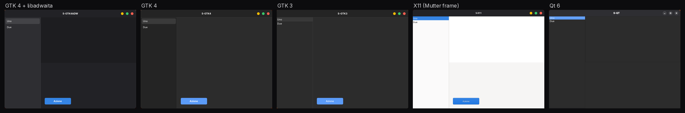
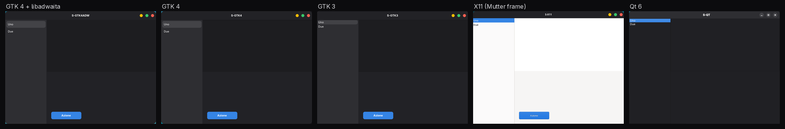
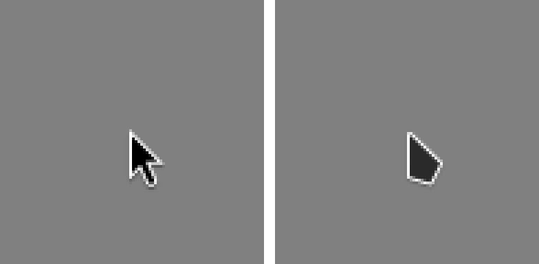
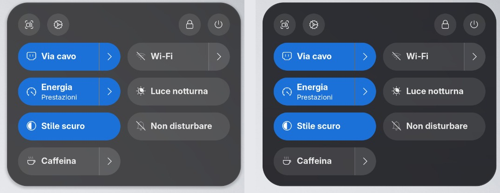
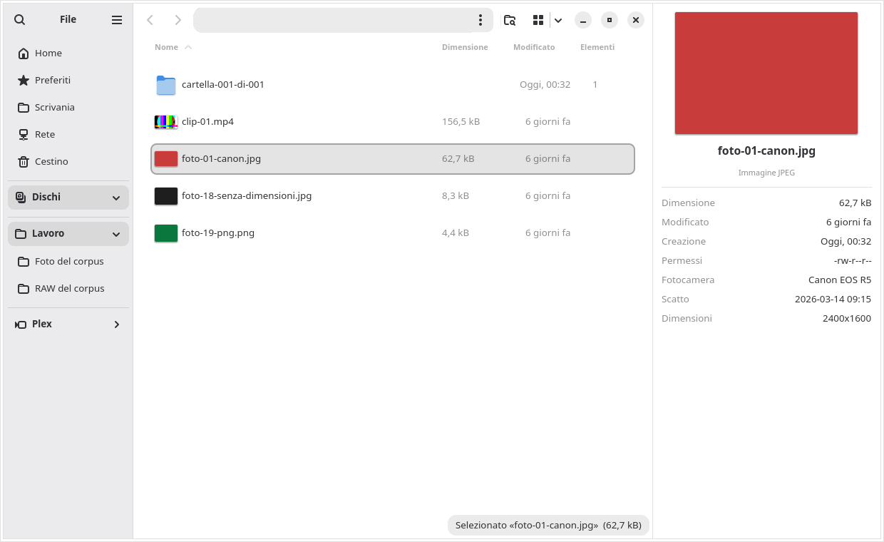
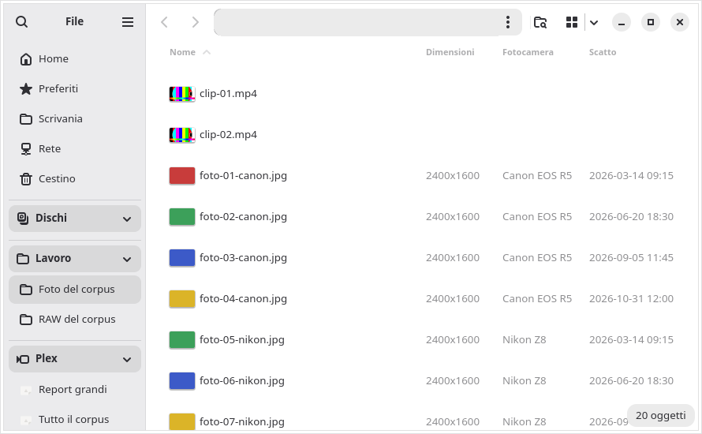

<h1 align="center">CodLab Thema</h1>

<p align="center"><b>A GNOME desktop that feels finished: one grey, one blue, one cursor, a file manager on its way to doing more than Explorer and Finder — and an honest record of how far we have got.</b></p>

<p align="center">English · <a href="README.de.md">Deutsch</a> · <a href="README.it.md">Italiano</a></p>

> **Status, 5 November 2026.** A working prototype on one development workstation (Fedora 45, GNOME Shell 51,
> GTK 4.24, libadwaita 1.10), **not yet an installable package**. This repository is a public report — what we
> measured, what we chose, what is done and what is not — and, since 5 November, also the **source code of the pieces
> installed on that workstation**, published as installed ([§11](#11-code-in-this-repository)). Which pieces the
> independent reviewers have signed is in [§7](#7-honest-status). Packages will follow.

## Contents

1. [The problem: the seams](#1-the-problem-the-seams)
2. [What we measured](#2-what-we-measured)
3. [Our choices](#3-our-choices)
4. [Files: to outdo Explorer and Finder](#4-files-to-outdo-explorer-and-finder)
5. [Launching apps like on a Mac](#5-launching-apps-like-on-a-mac)
6. [How we work](#6-how-we-work)
7. [Honest status](#7-honest-status)
8. [What no theme can fix](#8-what-no-theme-can-fix)
9. [Roadmap to the package](#9-roadmap-to-the-package)
10. [Names, credits, licence](#10-names-credits-licence)
11. [Code in this repository](#11-code-in-this-repository)

## 1. The problem: the seams

On macOS or Windows you rarely notice who drew the window you are looking at. On a Linux desktop you often do.
Move from one app to the next and the seams show: a slightly different grey, a different blue, window buttons in
another style, a cursor that changes shape, an app that looks as if it came from another decade.

Each seam is small. Together they are the gap that people feel between Linux and the two commercial desktops, even
when Linux is faster, more flexible and more open. **CodLab Thema exists to close that gap**: every seam we can
control, measured and closed; every seam we cannot control, named.

## 2. What we measured

### 2.1 Who actually draws your apps

GNOME's own apps use GTK 4 with libadwaita (the GNOME Shell itself is drawn with its own toolkit, St, built on
Clutter). The apps people use all day often do not. On our prototype, of the **17 apps pinned to the dock only 5** use GTK 4 with libadwaita:

| Toolkit | Apps in the dock |
|---|---|
| GTK 4 + libadwaita | 5 |
| Chromium / Electron (browser, chat, password manager, …) | 5 |
| Qt 6 | 2 |
| Flutter | 1 |
| Gecko | 1 |
| GTK 3 | 1 |
| X11 / CEF (Steam) | 1 |
| A game | 1 |

A theme can only reach apps that ask the system how to draw themselves: GTK 3, GTK 4 and, in part, Qt. **No theme
reaches apps that draw everything themselves** — Chrome with its own theme, Electron, Flutter, Steam, games. We say
this up front rather than promise it away (see [§8](#8-what-no-theme-can-fix)).

### 2.2 How far apart "the same theme" really is

Even among the apps a theme does reach, the desktop we started from had **two greys and three blues**: GTK 4 apps
used libadwaita's cool grey and blue, GTK 3 apps and X11 window frames used the theme's neutral grey and a lighter
blue, and the Shell used a third blue.

We measured it in an **isolated session**: a headless GNOME Shell 51 with a copy of the settings, the same scale and
five small test windows of our own, one per toolkit. Colours are read from the pixels and compared with CIEDE2000
(ΔE00; roughly, 1 is a just-noticeable difference, above 2 you see it when two windows sit side by side).

| Surface (largest difference between GTK 4 + libadwaita, GTK 4, GTK 3 and an X11 frame) | Before | After |
|---|---:|---:|
| Accent (selection, buttons) | 7.81 | **0.00** |
| Content area | 5.17 | **0.00** |
| Sidebar | 4.28 | **0.00** |
| Window background | 4.21 | **0.00** |
| Header bar | 2.93 | **0.00** |

The spacing of the window buttons is now the same everywhere as well: a 30 px pitch between button centres on all
four, from a single design token. Qt is the exception and is declared partial: its header bar is still 3.8 apart and
its buttons stay grey (§7).

**Before** — the same five test windows, same session:



**After** — generated from one token file:



<sub>In the X11 window only the frame is drawn by the system; the white area is the test program's own drawing. The
Qt window keeps grey buttons (partial, see §7). Labels inside the windows are test strings.</sub>

### 2.3 The cursor that changed shape

GNOME Shell 51 draws cursors from SVG files (a `cursors_scalable/` folder). The cursor theme we used shipped only
bitmaps, so the Shell silently fell back to its own built-in arrow while GTK 3 and X11 apps used the theme: two
different arrows on one screen, and **12 "Could not load cursor" errors in the log of a single login**. After
converting the theme to the Shell's SVG format: **0**.



### 2.4 Why not simply another theme?

- **A full theme on top of libadwaita has to be refitted at every GNOME release, twice a year.** The theme we started from added 9,536 lines of CSS over
  libadwaita at the highest priority. It changed shapes but not the base greys (hence the seams above), and it even
  altered app layouts: a calculator came out 365 px wide instead of 360.
- **Distributions that look seamless mostly hide the seams.** Zorin OS, for example, patches libadwaita to load its
  theme and stays on a fixed GNOME base for years; by its own documentation Flatpak and Snap apps stand out there
  too, as do Chrome with a Web Store theme, Electron and Steam. The idea — one family for every layer — is worth
  copying. On GNOME 51 that family already exists without patches: **Adwaita**.
- **We studied a libadwaita patch anyway.** A 186-line port works and keeps the library's interface identical. We do
  not need it for the look we chose, and it would not reach Flatpak apps, which use the libadwaita of their runtime.

## 3. Our choices

| Choice | What it means | Why |
|---|---|---|
| **Refined stock Adwaita, from one token file** | One `tokens.toml` generates the styles for GTK 4, GTK 3, the Shell and the Qt colours | One source cannot drift. Tests turn red if a generated file contains a hand-written colour or if a library changes underneath: 35 of 35 deliberately broken variants were caught. On the old setup the same test found 283 colours outside the tokens. |
| **One grey, one blue, one radius** | libadwaita's own surfaces, GNOME's system blue accent, a 15 px window radius | The system accent reaches the Shell and Flatpak apps for free; nothing to chase at every release. |
| **Icons and traffic-light buttons from Colloid** | The Colloid icon set; window buttons as 16 px circles with a 30 px pitch, drawn by a few rules of our own, identical on GTK 4, GTK 3 and X11 frames; grey in inactive windows | It keeps the character people like, at a small fraction of the maintenance of a full theme. |
| **One cursor** | The Colloid cursor in the Shell's SVG format, plus bitmaps for GTK 3 and X11 | One arrow, sharp at fractional scaling. |
| **Liquid glass** | The Shell's top bar, dock and pop-ups use a refraction effect (via the *Blur my Shell* extension) tuned to a tinted variant, the direction macOS 27 took | Every active text and icon is checked against the WCAG contrast thresholds (4.5:1 for text, 3:1 for icons); a variant is rejected if any element falls below its threshold, unless that element was already below it before and does not get worse. The light variant (4.37:1) and the extension's default (2.97:1) failed and were dropped. |
| **A more powerful Files** | Patches and extensions to Nautilus, as our own build of the package | §4 |
| **A Mac-style app launcher** | A full-screen launcher and a bouncing dock icon, as GNOME Shell extensions | §5 |

The token file is small and readable. An excerpt of the real file (its keys are in Italian: *accento* = accent,
*raggi* = radii, *semafori* = traffic lights, *passo* = pitch):

```toml
[accento]
nome_gnome = "blue"
bg = "#3584e4"

[raggi]
finestra = 15

[semafori]
diametro = 16
passo = 30
chiudi = "#fd5f51"
riduci = "#fdbe04"
ingrandisci = "#38c76a"
```

Liquid glass on the quick settings menu, same light background — before (blur) and after (tinted glass, installed):



## 4. Files: to outdo Explorer and Finder

As a tool, Windows Explorer is more complete than GNOME Files (Nautilus): a details pane, grouping, metadata
columns, a search scope. Files is cleaner and more consistent. We are closing the gap inside Files itself, in small
releases of our own build (`…codlab`), each with a rollback to the previous one. Doing more than Explorer and Finder
is the goal of v1 (§9); the table shows where we stand today.

| Feature | What it does | Status |
|---|---|---|
| **Item counts** | An "Items" column for folders, sortable and cached; now counted once instead of twice (directory walks per folder 2.00 → 1.00, measured with `strace`) | ✅ installed · signed |
| **RAW thumbnails** | Previews for CR2, CR3, NEF, ARW, RAF, DNG, ORF and RW2, from the JPEG embedded in the file; no new packages | ✅ installed · signed · verified on a synthetic corpus, *partial* on real camera files |
| **Photo columns** | Dimensions, camera and date taken in the list view | ✅ installed · signed |
| **Search "only here"** | "Only here" or "also in subfolders" in the search pop-over, as in Explorer; with "only here" no folder below the current one is opened | ✅ installed · signed |
| **Details pane** | Alt+P or the menu: a large preview and the metadata of the selected file (EXIF with orientation, video duration and resolution; for several selected files, their total size); the state is remembered; no new dependencies | ✅ installed · signed |
| **Group by** | Type, date or size, with section headers as in Explorer | 🧪 written and tested in isolation · review pending |
| **Sidebar blocks** | Groups such as *Disks* and *Work*, with disk names, colours and free-space bars | ✅ installed on the prototype · not yet reviewed · to become user-configurable |
| Next | Configurable blocks, dual pane, a Home view | 📋 planned |





<sub>Test data from a synthetic corpus. The path bar is blanked: it showed the folders of our test bench.</sub>

## 5. Launching apps like on a Mac

macOS 26 removed Launchpad in favour of an "Apps" view and Spotlight, and macOS 27 keeps it that way. What people
still miss is the gesture: **one key, all apps, type, go.** We built it for GNOME Shell 51 as two extensions:

- **Launchpad CodLab** (working name) — Super opens a full-screen app grid over the glass, the desktop fades in place; typing
  filters; Esc closes in one press; Super+W shows the windows.
- **Dock bounce** — the dock icon bounces while an app is starting, as on macOS, and it keeps bouncing even when the
  app is slow to start. The first version failed exactly there; the test now simulates a three-second start.

A third-party Spotlight clone was tested and rejected: it logged errors on Shell 51, took over the search and crashed
the isolated test shell once. Our own Spotlight-style search is the next increment.

**Status:** proven in the isolated session, not installed yet. One of the two reviewers has signed; the other has not
yet (usability 9.6 against a threshold of 9.8); the fixes for those points are written and await a new review.
*Screenshots will follow: the ones from the test session show a
third-party wallpaper and a personal dock, and will be re-shot on a neutral background.*

## 6. How we work

Every piece goes through the same chain, and the chain is the point:

1. **One writer, two independent reviewers.** Each piece has one author and two independent
   reviewers. The two reviewers who sign do not read each other's verdict, and **they execute**: they reproduce defects,
   run red-before/green-after checks and mutation tests (deliberately broken copies that the tests must catch). **The
   writer never signs its own work.**
2. **A score per area, no averages.** A piece goes into the package only at 9.5 out of 10 in every area. For the desktop we set the bar at
   **9.8 per area**, plus explicit boxes against macOS 27 and Windows 11 — "better in beauty: yes or no, with source and
   evidence". A 9.7 is a no.
3. **A gate before any review.** Clean checkout, full test suite, and a verifier that can actually turn red. A check
   that never fails verifies nothing.
4. **Isolation.** Every visual test runs in an isolated headless GNOME Shell with a copied settings database — never on
   the live session: no keystrokes or clicks there.
5. **Rollback first.** Every change is a numbered slice with its recorded before-state; its rollback is executed and
   measured before the slice counts.
6. **Honest measurements.** Timings are measured only on an idle machine (Linux pressure-stall information under fixed
   thresholds); otherwise the measurement is declared **not valid** — never a fake red or a fake green. What cannot be
   proven is declared **partial**.
7. **At most three closing rounds** per increment; after that the increment is split.

A real example: for Files 1.7.1 both reviewers refused the first round — a missing settings schema could abort Files,
and a new button in the search pop-over was not wired. After one closing round with red-before/green-after proof for
each defect, both signed, and it was installed.

## 7. Honest status

As of 1 November 2026, on the prototype workstation. "Installed" means installed there, where pieces are tried before
the package exists; the last column says what the independent reviewers have signed.

| Piece | On the prototype | Independent review |
|---|---|---|
| Refined Adwaita base from one token file (one grey, one blue, one radius) | ✅ installed | 🟡 fixes and tests signed by both; the 9.8 "better than macOS 27 and Windows 11" bar not yet (9.5 · 9.7) |
| Traffic-light buttons on GTK 4, GTK 3 and X11 frames | ✅ installed | 🟡 as above · Qt keeps grey buttons (*partial*; a workaround is prepared, not installed) |
| One cursor (SVG for the Shell, bitmaps for GTK 3 and X11) | ✅ installed | 🟡 one of two at 9.8 (9.8 · 9.7) |
| Liquid glass, tinted, in the Shell | ✅ installed on 1 November, by the owner's explicit decision | 🟡 one of two signed; the other: 9.1 against 9.5 on "beauty versus macOS 27" (large panels look flat on a light background) |
| Liquid glass, next tuning (newer *Blur my Shell*) | 🧪 prepared, not installed | ⏳ reviewed, not signed by either reviewer |
| Glass inside apps (GTK 4, starting with the Files sidebar) | 🧪 in progress | ⏳ first review not signed by either reviewer; fixes in progress |
| Files 1.7.1: item counts, RAW thumbnails, photo columns, search "only here" | ✅ installed on 31 October; included in 1.8.1 | ✅ signed by both after one closing round · RAW *partial* on real camera files |
| Files 1.8.1: details pane | ✅ installed on 1 November | ✅ signed by both after one closing round |
| Files 1.9: group by | 🧪 written and tested in isolation | ⏳ review pending |
| Files sidebar blocks with disk names, colours and space bars | ✅ installed | ⏳ not yet reviewed |
| Launchpad CodLab and dock bounce | 🧪 prepared, not installed | 🟡 one of two signed; the other: usability 9.6 against 9.8 · fixes written, new review pending |
| Chrome following the system theme | 🧪 prepared · needs one click in Chrome's settings | 🟡 9.7 · 9.7 |
| Uniform tray icons | ⚠️ *partial* | 🟡 not signed (9.2 · 9.4): some third-party apps load their tray icon by file path or as a bitmap, and no user-level override exists |
| The package: `codlab-thema`, signed repository, automatic rebuild | 📋 planned | — |

✅ done · 🟡 partly signed · 🧪 prepared or in progress · ⏳ pending · ⚠️ partial · 📋 planned

## 8. What no theme can fix

- **Apps that draw themselves**: Chrome (unless switched to its GTK mode), Electron and Flutter apps, Steam, games.
  macOS has the same problem with Electron, but it gives every window the same corners and shadow; GNOME does not draw
  the frame of Wayland apps.
- **Flatpak apps with libadwaita** use the library of their runtime, not the system's. They receive only the user's
  stylesheet and the system accent. That is why the CodLab look is built from libadwaita's own variables plus a few
  stable rules.
- **GNOME does not support themed apps** ("Please don't theme our apps", 2019). Any breakage caused by our styles is
  ours to fix: please report it to us, not to GNOME.
- **Features tied to Apple devices** (Continuity with the iPhone) have no path on Linux.

## 9. Roadmap to the package

**CodLab Thema will be one package**: one name to install, update and remove, one version, one settings app. The
metapackage `codlab-thema` pulls in:

| Part | Package |
|---|---|
| Styles generated from the tokens | `codlab-stile` |
| GNOME Shell extensions (glass, launcher, dock, refinements) | `codlab-shell` |
| Our build of Files | `nautilus` (same name, release suffix `.codlab`) |
| Files extensions (columns, thumbnails) | `nautilus-codlab` |
| CodLab Settings, with "Apply the CodLab profile" and "Back to how it was" | `codlab-impostazioni` |
| Signed repository | `codlab-repo` |

Principles: **never block the distribution's updates** — if our build is missing or late, Fedora's package wins and the
desktop falls back to stock Adwaita, so nothing breaks. Packages will be built on a dedicated build machine and signed
elsewhere; the signing keys never move. Installation and full rollback will be tested in a clean virtual machine
before every release. The next GNOME release (52) is expected on 17 March 2027.

| Step | Content |
|---|---|
| I0 | Census of the prototype's settings: general, machine-specific, to drop |
| I1 | "Style 0": one grey, one blue — the token generators as a package |
| I2 | The CodLab cursor |
| I3 | Files patches cleaned up and reviewed, own settings schema |
| I3b | User-configurable sidebar blocks; disk names and colours without touching system files |
| I3c | The CodLab profile with "Apply" and "Back to how it was" |
| I4 | Packages, signed repository, tested rollback |
| I5 | Automatic rebuild on every distribution update, with a gate |
| | **→ CodLab Thema 1.0** |
| I6–I13 | Files: details pane (done early, 1.8.1), grouping (in progress, 1.9) and filters, tags, type-to-jump, Home, dual pane → **v1, the goal: "better than Explorer and Finder"** |

Our estimate, in review-chain days (one increment through writing, gate and two executing reviews, at most three
rounds): **16–23 for version 1.0** and **38–57 for v1**; 7–10 per GNOME release to maintain 1.0. Distribution comes
first to our own machines; a public package repository after a stable release.

## 10. Names, credits, licence

**Names.** CodLab Thema is a working name. It is not affiliated with or endorsed by the GNOME Foundation, Fedora, Apple
or Microsoft. Our product names will not use their names ("Launchpad CodLab" is only the working name of a
prototype, after the macOS feature it recreates), and we copy none of their icons, cursors or fonts.
"Liquid glass" describes the effect; ours is called CodLab Vetro.

**Built on the work of** the GNOME project (Shell, Mutter, GTK, libadwaita, Files), adw-gtk3, the Colloid icon and
cursor themes, the *Blur my Shell* extension and Fedora. Thank you.

**Licence.** All code in this repository — extensions, scripts, packaging and Nautilus patches — is
[GPL-3.0-or-later](LICENSE). Copyright (C) 2026 CodLab UG (haftungsbeschränkt).

### Licenze / Licences

The report text stays under [CC BY 4.0](LICENSES/CC-BY-4.0.txt); screenshots in `docs/img/` stay under
[CC BY-SA 4.0](LICENSES/CC-BY-SA-4.0.txt). Neither is included in the binary packages. Component documentation
ships with the code under GPL-3.0-or-later. Third-party components keep their own licences. See [LICENSE.md](LICENSE.md).

## 11. Code in this repository

Since 5 November 2026 this repository also holds the source code of the pieces installed on the development
workstation, exactly as installed (only comments and descriptions were edited for publication). Every folder has a
short README — in Italian, with a one-line English summary — that says what the piece does and how to install and
remove it.

| Folder | What it is |
|---|---|
| [`extensions/vetro`](extensions/vetro/) | `vetro@codlab.de` — CodLab Vetro, the liquid glass for the top bar, dock, panel menus, banners and OSDs |
| [`extensions/vassoio`](extensions/vassoio/) | `vassoio@codlab.de` — the status icons of the top bar in order, symbolic and without duplicates |
| [`extensions/launchpad`](extensions/launchpad/) | `launchpad@codlab.de` — Launchpad CodLab: Super opens the full-screen app grid (prototype) |
| [`extensions/rimbalzo`](extensions/rimbalzo/) | `rimbalzo@codlab.de` — the icon of a starting app bounces in the dock (prototype) |
| [`extensions/dock-dal-bordo`](extensions/dock-dal-bordo/) | `dock-dal-bordo@codlab.de` — on secondary monitors the dock appears from the bottom edge |
| [`extensions/rifiniture`](extensions/rifiniture/) | `rifiniture@codlab.de` — readable filled active states, stylesheet only |
| [`extensions/quiete-aree`](extensions/quiete-aree/) | `quiete-aree@codlab.de` — no idle redraws while the workspace pop-up is shown |
| [`extensions/ricerca-azioni`](extensions/ricerca-azioni/) | `ricerca-azioni@codlab.de` — quick actions, conversions, emoji and recent files in the overview search |
| [`extensions/centro-notifiche`](extensions/centro-notifiche/) | `centro-notifiche@codlab.de` — a D-Bus interface to list and dismiss notifications |
| [`extensions/svuota-notifiche`](extensions/svuota-notifiche/) | `svuota-notifiche@codlab` — a "clear all" button on every notification |
| [`nautilus/vetro`](nautilus/vetro/) | `codlab-vetro.py` — the glass inside Files (nautilus-python) |
| [`nautilus/codlab`](nautilus/codlab/) | Nautilus 51.1-2.4 — the patch series for Files (sidebar blocks, details pane, search "only here", group by, group settings) and its spec |
| [`nautilus/integrazione`](nautilus/integrazione/) | `nautilus-codlab-integrazione`, `codlab-repo` — automatic rebuild on top of every Fedora Nautilus, local repository, RAW thumbnails, photo columns |

All pieces target GNOME Shell 51 and Files (Nautilus) 51 on Fedora 45. RPM and DEB packages contain the extensions;
Files itself is rebuilt separately from Fedora's source package with the patch series. The review status of each piece, as of 1 November, is
in [§7](#7-honest-status). Licences: see [LICENSE.md](LICENSE.md).

## 12. Packages and source installation

The `codlab-thema` RPM (Fedora 45, noarch) and DEB (Debian/Ubuntu, all) install ten system extensions,
compiled settings, symbolic icons, glass effects inside Files and documentation. They require **GNOME Shell 51**,
**Nautilus 51**, nautilus-python and **GTK 4.24**. Older desktops cannot satisfy these dependencies; the DEB does
not upgrade a distribution to GNOME 51. The package contains no Nautilus binary, report or screenshot.

Install the downloaded package with your distribution's administrator package manager:

```sh
dnf install ./codlab-thema-0.1.0-1.fc45.noarch.rpm
# Debian/Ubuntu, on a system meeting the version requirements:
apt install ./codlab-thema_0.1.0-1_all.deb
```

Then, as the desktop user, run `codlab-thema attiva`, `codlab-thema stato`, or `codlab-thema disattiva`.
Installation changes no user settings. New system extensions become visible at the next login. Run `disattiva`
before removing the package. Personal copies with the same extension UUID take precedence and must be resolved
by their owner before activation. Dash to Dock is an optional dependency for the dock features.

From a clean source checkout, run `packaging/build.sh /absolute/path/outside/the/repository/dist`.
Build requirements, behaviour and removal are in [the installed package guide](packaging/README.md).
The script runs `rpmbuild` with `%check` and `dpkg-deb` without root. Use the distribution package manager to
install its output; individual component READMEs also describe manual source installation. The Fedora 45
[Nautilus spec and patch series](nautilus/codlab/) remain separate source-only builds. The series does not apply
to Nautilus 48.3 shipped by [Debian stable](https://packages.debian.org/source/trixie/nautilus); that port is a
separate increment. The packaging checks run in isolated roots; they do not certify a graphical session.

## Sostieni CodLab Thema

CodLab Thema resta libero e gratuito. Se ti è utile, una donazione è gradita:
[PayPal CodLab](https://www.paypal.com/paypalme/codlabUG). Grazie!

*English: CodLab Thema is free software. If you find it useful, donations are welcome via the link above.*

---

<p align="center">Made by <a href="https://codlab.de/en/projects/">CodLab</a> · Regensburg area, Germany</p>
